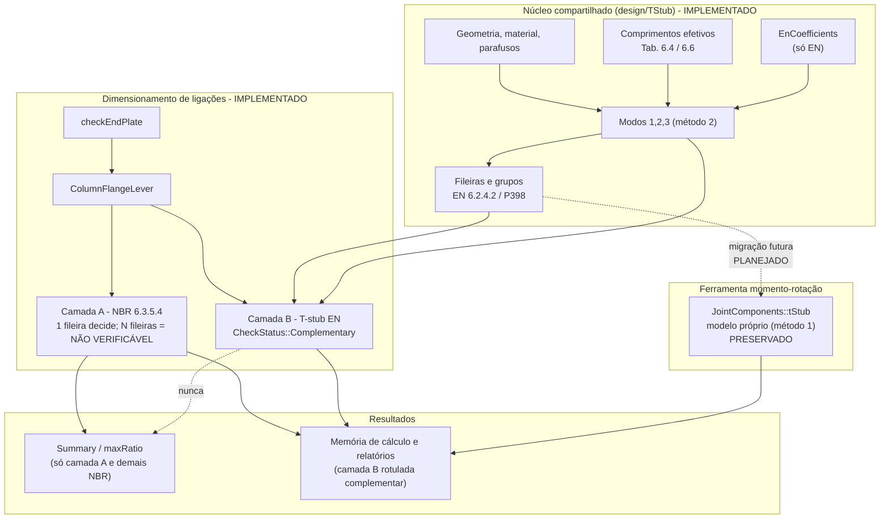

# Núcleo compartilhado de componentes T-stub

Documento de arquitetura. Legenda de estado usada em todo o texto: **[IMPLEMENTADO]**, **[PARCIAL]**, **[PLANEJADO]**, **[HIPÓTESE NÃO VALIDADA]**.
Metodologia e validação numérica: `docs/METODOLOGIA_ALAVANCA_MESA_PILAR.md` e `docs/validacao_alavanca/`. Este documento não declara validação profissional do módulo.

## 1. Introdução e motivação
Um mesmo componente físico de uma ligação — por exemplo, a mesa do pilar tracionada por parafusos — aparece em mais de um lugar do Structura: na verificação de dimensionamento e na ferramenta momento-rotação. Hoje o programa tem duas versões do mesmo mecanismo: o dimensionamento usa a equação de força localizada 5.7.2 (que não é um modelo de alavanca) e a ferramenta momento-rotação tem seu próprio T-stub em `JointComponents.cpp` (`tStub`, método 1, coeficientes da NBR dentro de fórmulas da EN).

Duplicar um componente físico cria três riscos: (i) resultados incoerentes entre módulos para a mesma ligação; (ii) correções feitas em um lugar e esquecidas no outro; (iii) coeficientes de normas diferentes misturados sem que ninguém perceba. O núcleo compartilhado existe para que o **cálculo mecânico do T-stub seja escrito uma única vez** e para que cada norma o consuma com seus próprios critérios.

## 2. Conceito de componente compartilhado
Representar um componente uma só vez significa separar o que é **fato físico** do que é **critério normativo** e do que é **comportamento**:

| Camada | O que é | Onde vive |
|---|---|---|
| Geometria | `m`, `e`, `n`, `ew`, comprimentos efetivos | `TStub::Geometry`, `TStub::EffectiveLength` **[IMPLEMENTADO]** |
| Propriedades mecânicas | `fy`, `tf`, resistência do parafuso | `TStub::Material`, `TStub::Bolts` **[IMPLEMENTADO]** |
| Resistência última | `F_T,Rd`, modos 1/2/3 | `TStub::resistance` **[IMPLEMENTADO]** |
| Rigidez | `k4`, `k5`, rigidez inicial | **[PLANEJADO]** (hoje só em `JointComponents.cpp`) |
| Lei força-deformação | curva, deformação última | **[PLANEJADO]** |
| Critério normativo | coeficientes, hipóteses, estado de aprovação | `EnCoefficients` (EN) e `ColumnFlangeLever` (NBR) **[IMPLEMENTADO]** |

Resistência última, rigidez e lei força-deformação são grandezas relacionadas, mas diferentes (seção 6).

## 3. Arquitetura geral

Linhas tracejadas são previsões; a linha "nunca" indica a regra de que a camada B não alcança `Summary`.

## 4. Responsabilidades do núcleo T-stub (`src/design/TStub.{h,cpp}`)
- **Geometria** **[IMPLEMENTADO]**: `Geometry{m, e, emin, ew}`, `Material{fy}`, `Bolts{ftRd, count}`. Nenhum campo tem valor padrão silencioso: dados não positivos ou não finitos devolvem `Modes::valid = false` com a causa.
- **Comprimentos efetivos** **[IMPLEMENTADO]**: `columnFlangeRow` (Tab. 6.4, fileira isolada), `columnFlangeGroup` (Tab. 6.4, grupo, fileiras de extremidade e internas), `endPlateExtensionRow` (Tab. 6.6, fileira na extensão). Mesa enrijecida (Tab. 6.5) e demais fileiras da chapa **[PLANEJADO]**. Cada função carrega a referência da tabela em `EffectiveLength::source`.
- **Modos de falha** **[IMPLEMENTADO]**: `resistance` calcula `F1` (método 1 ou 2, Tabela 6.2), `F2`, `F3`, o mínimo e o modo governante, e devolve as linhas da memória de cálculo. A alavanca é assumida desenvolvida (EN 6.2.4.1, Nota 1).
- **Fileiras e grupos** **[IMPLEMENTADO]**: `columnFlange` avalia cada fileira isolada e cada grupo de fileiras consecutivas; a resistência efetiva da fileira `r` é `min(Rr ; min_j [Rgrupo(j..r) − Σ efetivas j..r-1])`, o procedimento do SCI P398. Identifica o grupo governante e a soma total.
- **Parâmetros** **[IMPLEMENTADO]**: `boltTensionResistance` (`k2 fub As/γM2`), tabelas de `As` (M12–M36) e de `dw` (largura entre vértices da cabeça, a partir da largura entre faces tabelada para M12, M16, M20, M22, M24, M27, M30 e M36: **[HIPÓTESE NÃO VALIDADA]**, efeito ≤ 1 % nos exemplos). Para os demais diâmetros (por exemplo M14, M18, M33) **não há valor tabelado**: `TStub::boltHeadWidth` devolve `tabulated = false` e uma **estimativa empírica**: largura entre faces `s = 1,5·db`, logo `dw = 1,5·db·1,1547 = √3·db ≈ 1,732·db` (largura entre **vértices**; `1,5·db` sozinho NÃO é o `dw`), mantida para não alterar o cálculo e **identificada como "VALOR ESTIMADO (hipótese empírica, não é dado normativo nem de catálogo)" na memória de cálculo da Camada B** **[IMPLEMENTADO]**. A afirmação anterior deste documento ("nenhum valor padrão silencioso") valia para os campos de entrada; a estimativa de `dw` era a exceção e agora é rotulada. A estimativa não foi comparada com catálogo de parafusos nesta tarefa.
- **Coeficientes** **[IMPLEMENTADO]**: `EnCoefficients{γM0 = 1,0; γM2 = 1,25; k2 = 0,9}` (valores recomendados). Hoje não é configurável pela interface (Anexo Nacional **[PLANEJADO]**).

## 5. Separação normativa
`TStub.h` não inclui nada da NBR; `ColumnFlangeLever` (camada A) não usa `EnCoefficients`. O mesmo componente geométrico (a mesa do pilar e as distâncias `b`, `a`, `m`, `e`) é lido pelas duas camadas, mas:

| | Camada A (NBR 8800:2024, 6.3.5.4) | Camada B (EN 1993-1-8) |
|---|---|---|
| Parafuso | `0,75 Ab fub/γa2` | `0,9 fub As/γM2` |
| Material da mesa | `fu`, `γa1 = 1,10` | `fy`, `γM0 = 1,0` |
| Distância `b` | literal, sem 0,8 r (aprovado) | `m = (g − tw)/2 − 0,8 r` |
| Largura | tributária `p = 3,5 b` (6.3.5.2) | comprimentos efetivos (Tab. 6.4) |
| Resultado | espessura requerida; participa da aprovação | resistência `F_T,Rd`, modo, η informativo |
Misturar seria usar a resistência de parafuso da NBR com os modos da EN, produzindo um número sem base em nenhuma das duas normas. A advertência de divergência compara as duas resistências **sem** tratá-las como fatores de segurança.

## 6. Relação com a ferramenta momento-rotação
Resistência e comportamento são problemas diferentes. O núcleo atual entrega **resistência última** de um T-stub. A curva momento-rotação precisa, por componente, de: rigidez inicial (`k4`, `k5`), relação força-deformação (trecho elástico, plastificação, endurecimento), comportamento não linear, resistência última, a rotação/deformação associada a ela e, se o modelo contemplar, a degradação ou a perda de capacidade (por exemplo, ruptura de parafuso, modo 3, é frágil; o modo 1 é dúctil). Uma resistência isolada **não** é uma lei constitutiva e o núcleo não deve ser confundido com uma.

**Estado atual [IMPLEMENTADO]:** a ferramenta momento-rotação mantém seu modelo próprio (`JointComponents.cpp`, inalterado: método 1, γ da NBR) e seu comportamento está preservado. As verificações novas de A2 são **ocultadas** da varredura de resistência em momento (`JointComponentService.cpp`, `ratiosOf`, via `isColumnFlangeLeverCheck`), porque aquela ferramenta calcula a resistência varrendo as razões de `checkEndPlate`; sem o filtro, a nova camada A alteraria a sua resistência.

**Filtro por origem explícita [IMPLEMENTADO]:** cada `Check` tem o campo `origin` (`CheckOrigin`: `Design`, `ColumnFlangeLeverNbr`, `ColumnFlangeLeverEn`, `DivergenceWarning`, `ColumnSectionInfo`, `Information`). `isColumnFlangeLeverCheck` testa a **origem**, não o nome; uma verificação de projeto que por coincidência tenha o nome de uma do A2 **não** é ocultada (teste `nameCoincidenceNeverHidesALegitimateCheck`). A origem da Camada A é atribuída pela estrutura de `columnFlangeLeverChecks` (tudo o que sai do bloco da Camada A), não por texto. A emenda viga–viga também descarta as verificações de pilar do A2 e a seção do pilar por origem; as demais verificações de pilar anteriores ao A2 ("Apoio:", "Painel de alma", enrijecedores) continuam identificadas por nome **[PENDENTE]**.

**Regressão quantitativa [IMPLEMENTADO] e seus limites:** `TestMomentRotationRegression` compara, em texto e sem tolerância numérica (12 algarismos significativos), 14 casos com a referência `src/tests/golden/momento_rotacao.txt` (rigidez inicial, Mj,Rd da EN e da NBR, 42 pontos da curva, métricas, secante/tangente, classificação, rótula bilinear equivalente e memória de cálculo). A referência foi gerada com o gancho do A2 **desligado** e é idêntica à saída com o A2 ligado; a única diferença posterior é a mensagem do caso C14. Limites: (i) a referência mantém A1/M2 (o estado anterior a eles não é reconstruível pelo git); (ii) não executa o solver global com a rótula equivalente, apenas `deriveEquivalent`; (iii) são 14 casos (chapa de extremidade e mesas soldadas), não o espaço de projeto; (iv) a comparação é textual: mudar de compilador ou de arredondamento exige regravar a referência com justificativa; (v) desligar o filtro faz o teste falhar (verificado).

**Lacuna conhecida:** a alavanca da mesa do pilar **não participa do confronto de nível C** (Mj,Rd da NBR) da ferramenta momento-rotação, para nenhum número de fileiras, como antes do A2; a ferramenta também não herda o NÃO VERIFICÁVEL de várias fileiras **[PENDENTE]**.

A migração **[PLANEJADO]** exige: (i) estender o núcleo com rigidez e lei força-deformação; (ii) decidir método 1 × 2 e conjunto de coeficientes da ferramenta; (iii) comparar quantitativamente curvas antigas e novas e aprovar as diferenças; (iv) não migrar sem esses passos.

## 7. Fluxo de dados
1. `ConnectionService::toEndPlate` monta `EndPlateInput` (seção do pilar: barra de apoio ou geometria confirmada, A1).
2. `checkEndPlate` valida entradas (`InputValidation`); com dados inválidos, devolve só `NÃO VERIFICÁVEL`.
3. Calcula a tração `T = M/z + N/2` e chama `columnFlangeLeverChecks(input, T)`.
4. A camada A (NBR) produz uma verificação avaliada, `NÃO VERIFICÁVEL` (várias fileiras, dados inválidos) ou `NÃO APLICÁVEL` (sem tração).
5. A camada B monta `TStub::ColumnFlangeInput` (e a chapa, para 1 fileira), obtém `ColumnFlangeResult` e devolve um `Check` com `status = Complementary`.
6. Se houver as duas resistências válidas e `R_A ≥ 1,10 R_B`, acrescenta a advertência (também complementar).
7. `Evaluation`, diálogo, memória e relatório leem os `Check`; apenas `Evaluated` e `Unverifiable` entram em `summarize`.

## 8. Estados e resultados
| Estado | Significado | Entra em `Summary`/aprovação? |
|---|---|---|
| Aprovado / Reprovado (`Evaluated`) | verificação calculada; razão ≤ 1 ou > 1 | sim |
| Não verificável (`Unverifiable`) | dado ausente/inválido ou configuração fora do escopo validado | sim: impede a aprovação |
| Não aplicável (`NotApplicable`) | sem demanda, com justificativa | não impede, mas lista só com NA não aprova |
| Informação (`Information`) | registro de dado usado | não |
| Complementar (`Complementary`) | método fora da norma de projeto, com números para exibição | **nunca** |

A camada B é `Complementary` porque a NBR 8800 não define o T-stub nem seus comprimentos efetivos: tratá-la como verificação poderia aprovar ou reprovar uma ligação com base em uma norma que não é a de projeto, e a metodologia aprovada a mantém informativa até a validação adicional. Garantia testada: `summarize` com e sem as verificações complementares dá o mesmo resultado (`TestTStub::complementaryLayerNeverChangesTheGlobalResult`).

**Identidade visual do estado `Complementary` [IMPLEMENTADO]:** rótulo "MÉTODO COMPLEMENTAR — NÃO PARTICIPA DA APROVAÇÃO GLOBAL" precedido do glifo "◇", cor índigo (`#5b4bb7` no diálogo; `#4b3fa0` sobre fundo `#ece9fa` no relatório HTML/DOCX) e itálico no diálogo, distintos do cinza (`#6b7785`) de INFORMAÇÃO e NÃO APLICÁVEL, do vermelho (reprovado/não verificável) e do verde (aprovado). A semântica não mudou. No relatório o título da verificação complementar usa o estilo de nota. A disponibilidade do glifo "◇" na fonte do Word/PDF não foi verificada.

**Advertência de divergência [IMPLEMENTADO]:** condição inalterada (R_A ≥ 1,10 · R_B, uma fileira, as duas camadas válidas). É um `Check` complementar **sem** demanda, resistência ou índice; sua apresentação é uma mensagem: "Divergência entre metodologias: Camada A (NBR) = X kN; Camada B (EN) = Y kN. A estimativa da Camada A é Z% superior à da Camada B. Resultado informativo, sem influência na aprovação global." No diálogo e no relatório a mensagem ocupa a coluna do nome da verificação; as colunas de solicitação e resistência mostram "-".

## 9. Estratégia de testes e validação
- **Benchmarks independentes [IMPLEMENTADO]** (`src/tests/TestTStub.cpp`): SCI P398 Exemplo C.1 (mesa: fileira 1 = 398, grupos 697 / 988 / 691 kN; chapa: 901/377/406 kN; comprimentos efetivos 210/233 e 191/125) e as 26 amostras do método dos componentes da verificação de T-stub da IDEA StatiCa. Tolerância de **2 %**, a mesma do plano; as diferenças reais ficam em até ≈ 1,9 % (scripts: `docs/validacao_alavanca/`).
- **Propriedades [IMPLEMENTADO]**: monotonicidade em `tf`, `F_T,Rd ≤ ΣFt,Rd`, grupo ≤ soma das isoladas, método 1 ≤ método 2 no modo 1, os três modos aparecem.
- **Camada NBR [IMPLEMENTADO]**: HEB200 (256,39 kN) e UKC 254×254×107 (406,66 kN) conferidos com a reimplementação independente em Python; `β < 0`, `δ` inválido, dimensões nulas/negativas, `a > 1,25 b`, múltiplas fileiras = `NÃO VERIFICÁVEL`.
- **Estados [IMPLEMENTADO]**: camada B aprovada ou reprovada não altera o global; camada A de 1 fileira participa; advertência não altera o global.
- **Regressão**: golden (74 seções numericamente iguais; só entram as linhas novas), 51 casos de `TestJointClassification` da ferramenta momento-rotação, `TestDesign`, `TestConnectionCatalog`.
- **Limitações da validação**: as referências são cálculos publicados (EN) e um MEF sólido publicado; **não há MEF próprio nem exemplo resolvido da NBR 6.3.5.4**; a camada A só foi validada mecanicamente (seção 4.3 da metodologia).

## 10. Limitações atuais
- Camada A: apenas 1 fileira; várias fileiras são `NÃO VERIFICÁVEL` por decisão (interação não validada por MEF independente). Hipóteses H1 (b literal, aprovada) e H2 (bordas do pilar afastadas, `p = 3,5 b`) **[HIPÓTESE NÃO VALIDADA]**; extensão do 6.3.5.4 à mesa laminada com filete **[HIPÓTESE NÃO VALIDADA]**.
- Camada B: sem alma do pilar tracionada (6.2.6.3), sem alma da viga tracionada (6.2.6.8), sem mesa enrijecida (Tab. 6.5); chapa de extremidade só na fileira da extensão em ligações de 1 fileira (**[PARCIAL]**); parafusos ASTM usam `fub` do usuário, sob responsabilidade do projetista; coeficientes fixos nos valores recomendados.
- Uma segunda implementação das equações 6.3.5.2–6.3.5.4 existe em `checkPrying` (chapa) e em `nbrPrying` (mesa do pilar); a unificação **[PLANEJADO]** exigiria mexer no golden da chapa.
- A emenda viga–viga (que não tem pilar) descarta as verificações de A2.
- Ferramenta momento-rotação: a alavanca da mesa do pilar não entra no confronto de nível C (seção 6).
- Pilar não informado na ferramenta momento-rotação: mensagem "Rigidez não calculável: informe ou confirme a seção do pilar e suas propriedades geométricas e mecânicas." (nenhum pilar padrão é restaurado).
- Efeito de 2 ou mais fileiras tracionadas: todas as ligações com várias fileiras (inclusive a ligação padrão sugerida pelo programa, 2 fileiras) ficam `NÃO VERIFICÁVEL` até a camada A ser habilitada para elas.

## 11. Roadmap
1. Migração controlada do T-stub de `JointComponents.cpp` para o núcleo (com regressão quantitativa de curvas) — **[PLANEJADO]**.
2. Rigidez (`k4`, `k5`, bolt) e lei força-deformação no núcleo — **[PLANEJADO]**.
3. Integração resistência última ↔ curva momento-rotação (modos e capacidade de rotação) — **[PLANEJADO]**.
4. Outros componentes: alma do pilar tracionada/comprimida, painel de alma, chapa de base — **[PLANEJADO]**.
5. MEF independente de grupos de 2–3 fileiras para habilitar a camada A em várias fileiras — **[PLANEJADO]**.
6. Anexo Nacional configurável; mesa enrijecida; unificação de `checkPrying` e `nbrPrying` — **[PLANEJADO]**.

## 12. Rigidez inicial do T-stub (A3, Fase B) **[IMPLEMENTADO, validação parcial]**
Arquivo próprio `src/design/TStubStiffness.{h,cpp}` (matemática pura, sem NBR, sem `Check`): `flangeBending` (k4/k5 = 0,9·leff·t³/m³), `boltsInTension` (k10 = 1,6·As/Lb), `seriesCoefficient`, `tStubStiffness` (série mesa/chapa + parafusos, uma fileira) e `forceStiffness` (k·E). Coeficientes em `EnStiffnessCoefficients`, **separados** de `EnCoefficients`; todos os dados são obrigatórios (NaN = não informado → inválido). **Não é chamado pelo dimensionamento nem pela ferramenta momento-rotação**: nenhuma verificação, memória de verificação, resistência ou curva mudou (testes TestTStub, TestGoldenNumerics e TestMomentRotationRegression inalterados e aprovados). Referências, equações, hipóteses e a validação (valores publicados do exemplo SCIA e do C2 do P398; sem MEF nem ensaio) estão em `docs/METODOLOGIA_COMPORTAMENTO_MECANICO_TSTUB.md`. **[PLANEJADO]:** várias fileiras, lei força-deslocamento e capacidade de deformação (**[LACUNA]** bibliográfica), integração entre componentes. A divergência de `leff` de rigidez entre o núcleo/EN (menor valor, individual ou de grupo) e `JointComponents.cpp` (só fileira isolada) está registrada na metodologia e **não foi corrigida**.

## 13. Situação real da interface e do catálogo (saneamento pós-A2)
- **Executado e testado:** o diálogo real de ligações (`NodeConnectionsDialog`), a memória de cálculo e o relatório HTML/DOCX, fora da tela (`TestPostA2Sanitation`, `TestDocxEncoding`). **Não executado:** a janela principal do aplicativo, a exportação real para PDF e a abertura do DOCX no Word.
- **Catálogo [IMPLEMENTADO]:** o padrão continua com 2 fileiras. Em ligação de chapa de extremidade com 2 ou mais fileiras o diálogo mostra um aviso (a verificação NBR da mesa do pilar, 6.3.5.4, só está liberada para 1 fileira; com mais, o resultado é NÃO VERIFICÁVEL; o T-stub EN é só informativo) e o botão **"Usar 1 fileira"**. Nada muda sem o clique; o clique altera `tRows` para 1, atualiza desenho e verificações e registra a ação no aviso. A emenda viga–viga não mostra o aviso.
- **DOCX [IMPLEMENTADO]:** corrigido o corte de caracteres UTF-8 multibyte em `FormulaText::mapIdentifier` (a inicial de um identificador era tomada como 1 byte, partindo letras gregas como "γ" em `γa1`) e descartados caracteres de controle ilegais em XML 1.0. Validado por análise estrutural própria do pacote OOXML (zip, tipos, relações, XML bem formado, UTF-8 válido); **não foi aberto no Word**.

## 14. Conclusão arquitetural
O núcleo separa o que é mecânica (geometria, comprimentos efetivos, modos, grupos) do que é critério (coeficientes, hipóteses, estados). Isso permite ao dimensionamento NBR e ao método EN complementar compartilharem a mesma descrição do componente sem misturar normas, e abre caminho para que a ferramenta momento-rotação deixe de manter uma cópia própria do mecanismo. Enquanto a migração e a validação de várias fileiras não forem feitas, o núcleo reduz a duplicação apenas no dimensionamento; a consistência plena entre módulos continua sendo um objetivo, não um fato.
