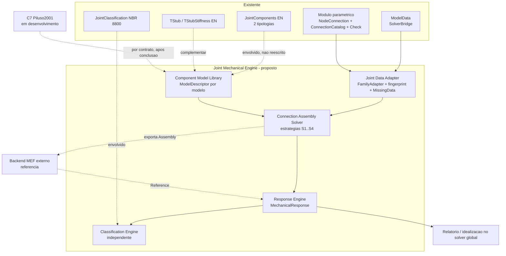
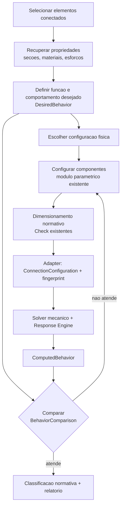
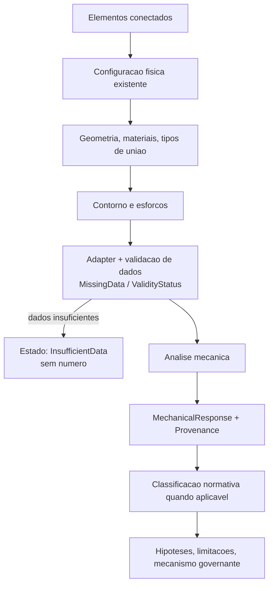
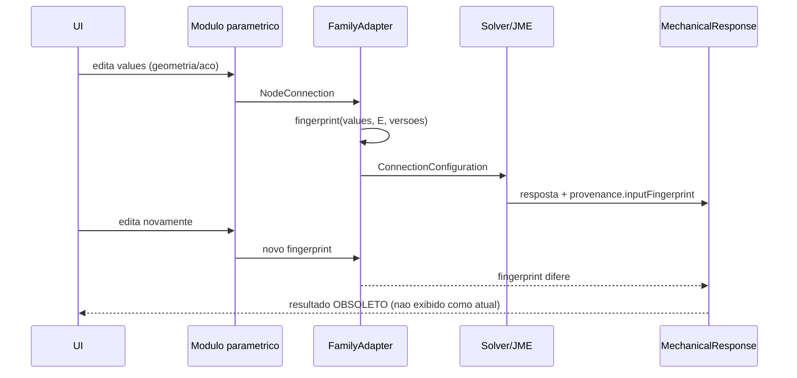
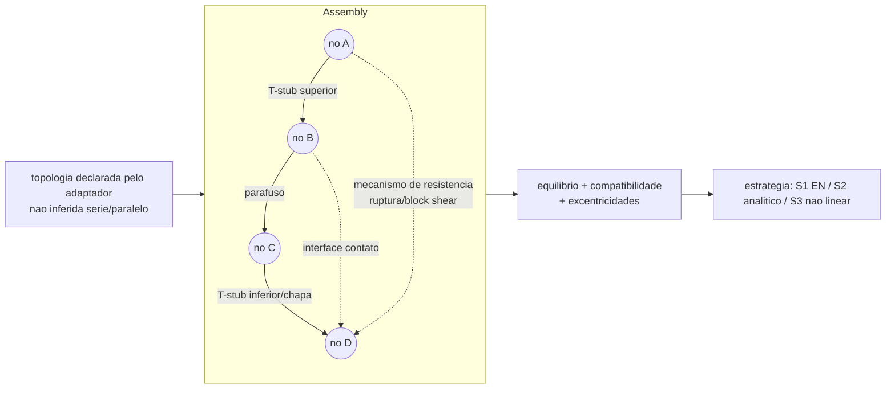
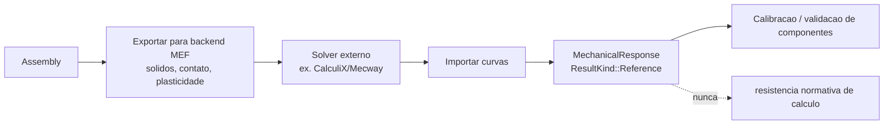
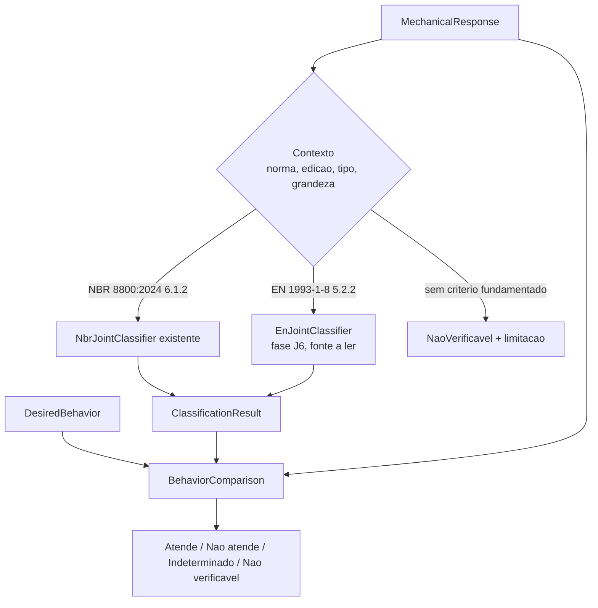

# Diagramas da arquitetura D0 (Mermaid)

## 1. Arquitetura geral

## 2. Fluxo A — projeto de nova ligacao

## 3. Fluxo B — analise de ligacao existente

## 4. Integracao parametrica e invalidacao

## 5. Composicao mecanica

## 6. Caminho MEF

## 7. Classificacao normativa

